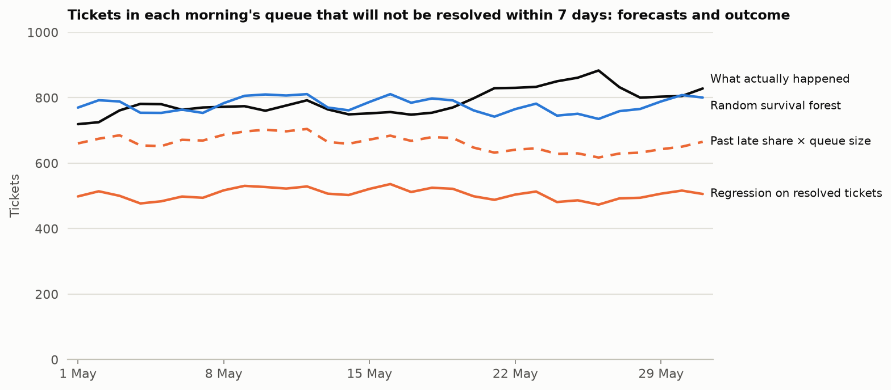
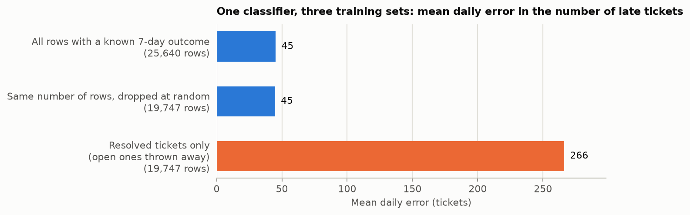

# When will this ticket be done?

A support desk has about 1,200 tickets open every morning, and its manager keeps asking two things:
*how long does our work take?* and *how many of the tickets open right now will still be here in a
week, and which ones?* This project answers both on the tickets of an IT company (24,918 incidents,
141,712 logged updates; a ServiceNow export published on UCI).

One idea runs through all of it: **work that is not finished yet has to stay in the calculation.**
Every measurement and every forecast that drops the open tickets comes out too optimistic.

In short:

1. The usual report understates how long work takes, because it averages finished tickets only:
   3.7 days shown against 9.1 days true on one date, and too low on 17 Mondays out of 17. The true
   mean cannot be known on the day. The median and the percentiles can, once the open tickets are
   counted (Kaplan–Meier): median 2.03 days estimated, 2.02 in the end; the report said 1.04.
2. "It has been open for 5 of the average 7 days, so 2 to go" is wrong: a ticket that has been open
   for 1 day typically has 5.6 more days to go, one open for 28 days has 27.
3. *How many* of this morning's tickets will still be open in a week can be forecast to within
   about 40 tickets a day out of 788. A spreadsheet calculation misses by about 70; a model that
   learns from finished tickets only misses by 282. A survival model is not required for this.
   Keeping the open tickets in the training data is.
4. *Which* tickets to look at first: no model beats the rule "oldest first" in a way that matters.
   The models look better only because one team holds a fifth of the queue and is nearly always late.

The demo (`streamlit run app/app.py`, interface in Turkish) goes back to any day of May 2016, ranks
that morning's open tickets by their risk of being late, and can then reveal what really happened.
A one-page summary in Turkish is in [reports/OZET.md](reports/OZET.md).

## Findings

All numbers below are produced by `python run_all.py` and checked in `tests/`.

### 1. The average of resolved tickets understates how long work takes

Every Monday from 7 March to 27 June 2016 the clock is stopped and "how long do our tickets take?" is
answered three ways for the tickets opened so far: from the tickets already resolved that day (what a
report built on finished work shows), with Kaplan–Meier (which also counts the tickets that are still
open, as "open for at least this long"), and with what later turned out to be true.


| On 4 April 2016 (16% of tickets still open) | Resolved tickets only | Kaplan–Meier | What actually happened |
|---|---|---|---|
| Mean (days) | 3.7 | cannot be estimated | 9.1 |
| Median (days) | 1.04 | 2.03 (95% CI 2.0–2.1) | 2.02 |
| 90th percentile (days) | 11.9 | 20.1 | 19.1 |
| Resolved within 7 days | 79% | 68% | 70% |

- **The resolved-only mean is below the truth on all 17 Mondays.** With 98% of tickets resolved at
  the end of June it is still 4.5 days against 6.9.
- **Nothing recovers the true mean on the day.** The slowest tickets are still open and nobody knows
  yet how long they will take, so the mean is not estimable; this is a property of the data, not of
  the method.
- **The median and the percentiles are estimable, once there is enough data.** From 21 March on the
  Kaplan–Meier median is within 0.06 days of the truth, from 4 April on within 0.005 days. In the
  first two weeks it is not usable: on 7 March, with 53% of tickets open, it cannot be estimated,
  and on 14 March it says 3.7 days against 3.3. The 90th percentile becomes estimable on 28 March.
- **This is not the effect of one team.** Without the 454 tickets that were ever handled by the team
  holding most of the long-running work (see finding 4), the report still says 3.7 days against a
  true 7.7 on 4 April, it is too low on all 17 Mondays, and the Kaplan–Meier median is 1.97 against 1.97.

Broken down by opening week, the report of 2 May shows the most recent week at 0.3 days on
average; those tickets ended at 3.7 days. Times really were falling, but the report exaggerates it.


### 2. The longer a ticket has waited, the longer it still has to wait

The intuitive rule is "tickets take 6.9 days on average, this one has been open for 5, so about 2 to
go". Measured on the complete data, the median remaining time goes the other way:

| Ticket has been open for | Still open | Median remaining (95% bootstrap interval) | Resolved within next 24 h |
|---|---|---|---|
| just opened | 24,918 | 0.63 days (0.46–0.71) | 55% |
| 1 day | 11,228 | 5.6 days (5.3–5.8) | 16% |
| 7 days | 5,286 | 7.1 days (7.0–7.3) | 12% |
| 28 days | 1,235 | 27.0 days (23.2–28.9) | 5% |


What this does and does not show:

- It describes **which tickets are left** in an old queue: the quick ones are gone. It does not show
  why the remaining ones take long, or that waiting makes a ticket slower.
- The pattern is not a smooth law. The share resolved in the next 24 hours does not fall at every
  age: it is 9% at 4 days and 12% at 6 days, 7% at 10 days and 10% at 14 days.
- **It is not one team.** Among tickets never handled by that team the same three ages give 5.2, 6.8
  and 18.1 days.
- **It is not batch entry.** If resolutions were typed in in batches on a weekly calendar, the
  pattern would say something about bookkeeping, not about the work. Only 0.4% of tickets are
  resolved in a minute in which five or more tickets are resolved (never more than six), and without
  them the three medians are unchanged (5.6, 7.1, 27.0). 1.1% of tickets are resolved within an hour
  of a whole number of weeks after they were opened. (Administrative *closing* does follow a
  calendar: it comes five days after resolution. Everything here is measured to resolution.)

### How the forecasts are tested

"Late" means not resolved within 7 days of the day the queue is looked at. Models are fitted on what
was known on 1 May 2016: 28,125 rows (tickets open at cutoffs every 3 days in March and April), 28%
of them still open on 1 May. They are tested on the queue of open tickets at 00:00 on each of the 31
days of May: about 1,200 tickets a day, 66% of them late.

| Method | What it is |
|---|---|
| Oldest first | The rule of thumb: the ticket open longest is the riskiest. Ranks only. |
| Team's past late rate, then oldest | Rank by how often the ticket's team was late so far. Ranks only. |
| Past late rate by age band | No model: the share of past tickets of the same age that were late. |
| Regression on resolved tickets | Log-normal regression on the tickets already resolved; the open ones are thrown away. |
| Kaplan–Meier by age | One survival curve for all tickets, conditioned on age. No ticket attributes. |
| Cox proportional hazards | Survival regression; open tickets are kept as "open for at least this long". |
| Random survival forest | The same, with trees. This is the model in the demo. |
| Gradient boosting classifier | Not a survival model: answers "late or not?" directly, fitted on every row whose 7-day outcome was known on 1 May (a ticket still open after its 7 days is a "yes"). |

Three things about this test are worth knowing before reading the results:

- **The models never saw a May outcome, but they did see some of the tickets.** 1,039 of the 4,078
  tickets in the May queues were already open in April and are in the training rows as they looked
  then. They make up 48% of the May rows. Results for the other 3,039 are given separately in finding 4.
- **The 31 days are not 31 independent tests.** A ticket stays in the queue for 9 days on average,
  so neighbouring queues are mostly the same tickets. The intervals below therefore resample
  *tickets* (all days of a ticket together, 1,000 times); the models are not refitted in them.
- **"Late" is counted to the ticket's final resolution.** A ticket resolved within the week and
  reopened later counts as late.

The forest's leaf size and the classifier's tree size are the only settings tuned, on April data
(`reports/tables/model_selection*.csv`).

### 3. How many tickets will be late

A manager planning the week needs a count: of the tickets open this morning, how many will still be
open in 7 days? A model's forecast is the sum of its late probabilities over the queue. On average
788 tickets of a May queue turned out late (between 719 and 883).

| Forecast for each of the 31 May queues | Mean forecast | Mean miss, tickets a day [95% interval] | Days the forecast was too low |
|---|---|---|---|
| No model: late share of all past queues (55.2%) × queue size | 662 | 126 | 31 |
| No model: late share of the latest queue with a known outcome (60.0%) × queue size | 719 | 69 | 29 |
| No model: past late rate by age band | 715 | 74 [61–90] | 29 |
| Regression on resolved tickets only | 506 | 282 [258–305] | 31 |
| Kaplan–Meier by age (no ticket attributes) | 778 | 40 [35–49] | 14 |
| Cox proportional hazards | 767 | 44 [39–54] | 17 |
| Random survival forest | 777 | 43 [38–51] | 14 |
| Gradient boosting classifier | 788 | 45 [39–53] | 14 |



- **Four methods miss by 40 to 45 tickets a day, about 5% of the count.** The forest is not better
  than Kaplan–Meier by age, which uses no ticket attribute at all (difference 3 tickets,
  interval -0.3 to 5.5).
- **The honest comparison is the spreadsheet calculation, about 70.** The no-model forecasts miss by
  69 to 126 and are almost always too low, because the queue was getting slower: 55% late over all
  March–April queues, 60% in the latest one whose outcome was known, 66% in May.
- **Without the one team of finding 4, the spreadsheet does as well as the models.** With that team
  taken out of training and test, 567 tickets a day are late; past late rates by age band miss
  by 47, the four methods above by 46–48, the regression on resolved tickets by 205.
- **Learning from resolved tickets only is the worst option, worse than using no model.** It is too
  low on every one of the 31 days, by 282 tickets on average.

**What makes the difference is keeping the open tickets, not the kind of model.** The same classifier
was fitted three times:

| Training rows of the classifier | Rows | Late share in those rows | Probability error (Brier) | Mean miss, tickets a day |
|---|---|---|---|---|
| All rows whose 7-day outcome was known on 1 May | 25,640 | 55% | 0.173 | 45 |
| Only tickets already resolved on 1 May | 19,747 | 42% | 0.264 | 266 |
| The same number of rows, dropped at random (3 seeds) | 19,747 | 55% | 0.173 | 45 |



Dropping the rows of tickets still open on 1 May makes the classifier far too optimistic. Dropping
the same number of rows at random changes nothing, so the damage comes from *which* rows are
dropped, not from having fewer. And a survival model is not needed to avoid it: the classifier that
keeps those rows does as well as the survival forest (finding 4). This is finding 1 again, in a forecast.

**The process drifts, and refitting helps only a little.** In the queues of 21–26 May the share
resolved within 7 days falls from the 34–41% of 1–19 May to 21–29%, and the forest, fitted on 1 May,
stays too optimistic (26 May: 34% predicted, 21% observed). Refitting every week on what is known
that day lowers the forest's mean miss over the month from 43 to 41 tickets and over 21–26 May
from 94 to 88. The optimism stays. Other refitting schedules were not tried.

### 4. Which tickets will be late

Each cell is the mean over the 31 daily queues.

| Method | Ranking (C-index) | Truly late among the riskiest 10% | Probability error (Brier) |
|---|---|---|---|
| Oldest first | 0.674 | 0.876 | no probability |
| Team's past late rate, then oldest | 0.686 | 0.972 | no probability |
| Past late rate by age band | 0.660 | 0.910 | 0.203 |
| Regression on resolved tickets only | 0.666 | 0.945 | 0.247 |
| Kaplan–Meier by age (no ticket attributes) | 0.673 | 0.878 | 0.189 |
| Cox proportional hazards | 0.690 | 0.982 | 0.180 |
| Random survival forest | 0.705 | 0.986 | 0.173 |
| Gradient boosting classifier | 0.705 | 0.985 | 0.173 |

For reference: random ranking has a C-index of 0.5, and giving every ticket the same 66% has a Brier
score of 0.225.


- **On the whole queue the forest ranks better than "oldest first"**: C-index 0.705 against 0.674
  (difference 0.031, interval 0.022–0.040), ahead on all 31 days.
- **The ordinary classifier does as well as the survival forest.** C-index 0.705 against 0.705
  (difference interval -0.003 to 0.003), Brier 0.173 against 0.173 (-0.001 to 0.002). Neither is shown
  to be better.
- **"Best" depends on the measure.** Among the riskiest 20% instead of 10%, Cox is ahead of the
  forest (0.973 against 0.962). The forest's results move little with its random seed
  (C-index 0.704–0.705 over 5 seeds).
- **The edge over the rule of thumb is one team.** Every ticket in the forest's riskiest 10% belongs
  to one assignment group ("Group 9"), which holds 18.9% of the May queue rows and 28% of the late
  ones, and whose tickets are late 97% of the time. With that team taken out of both training and
  test and every method refitted, the forest scores 0.662 against 0.659 for "oldest first"
  (difference interval -0.005 to 0.010) and 0.866 against 0.848 in the riskiest 10% (-0.018 to 0.044);
  the classifier scores 0.665 and Cox falls *below* the rule (0.64). Outside that team the models
  rank about as well as the rule of thumb, and the forest's difference cannot be told from zero.
  A team lead presumably knows about that team already.
- **On tickets the models had never seen**, the forest's C-index is 0.63 against 0.59 for
  "oldest first"; in the riskiest 10% the one-variable team rule is ahead of it (0.84
  against 0.82).
- **The probabilities are right on average, not everywhere.** The forest predicts 65% late overall;
  the truth is 66%. By team it can be far off: for the second-largest team (Group 20) it predicts
  54% late and 75% are; for Group 70, 39% against 20% (`reports/tables/check_calibration.csv`).


## Limits

- One company, tickets opened mostly in March–May 2016. Nothing here was checked on a second
  company or on a later period.
- The 7-day threshold was chosen for this project (79% of all tickets are resolved within 7 days;
  a week is also a planning unit). The export's own SLA flag could not be used: it depends on the
  closing date, which follows resolution automatically.
- Team and category names are pseudonyms. Why one team's tickets take so long cannot be read from
  the data.
- The model knows nothing about the calendar. On two cutoff days almost nothing was resolved in the
  following 24 hours, which looks like public holidays; not verified.
- What a different ranking would be worth to the desk (time saved, tickets rescued) was not measured.
- This is a replay of past data. No live system was built.

## How open tickets are recreated

Every ticket in the file is closed. To get "open" tickets, the clock is stopped at a cutoff time and
every update after it is hidden (`sql/03_snapshot.sql`). What is hidden is then used to score the
estimates. `tests/test_no_leakage.py` rewrites and deletes everything after the cutoff and requires
the snapshot to stay identical.

Four columns of the export (`resolved_at`, `closed_at`, `closed_code`, `resolved_by`) hold their final
value on every row of a ticket, including the first one, so they are kept out of the event table.
Resolution time is taken from the update log instead: the moment the ticket entered Resolved/Closed
for the last time. Where the export's `resolved_at` exists (23,362 tickets; it is missing for 1,556),
the two agree for 98.7%.

## If this ran in production

```
ticket system ──nightly export of updates──▶ events table ──open_at(today)──▶ open tickets as of this morning
                                                                                    │
          list of risky tickets, expected number late, per-ticket curve ◀── model ◀─┘
                                                                              ▲
                          refit on a schedule; check last week's forecast ────┘
```

Every night the ticket system's new updates are appended to the events table. In the morning the
`open_at` macro used here returns the tickets that are open as they stand, the fitted model scores
them, and the result goes to a screen like the demo. Two things would have to be added. First, a
refit on a schedule: fitted once on 1 May, the model was too optimistic three weeks later, and weekly
refitting reduced that only a little (finding 3). Second, a standing check that compares each
morning's forecast with what happened 7 days later, which is the table of finding 3 kept up to date.
None of this was built: ingestion, serving and reliability of a live system were not measured here.

## Run it

```bash
python -m venv .venv && .venv/bin/pip install -r requirements.txt
.venv/bin/python run_all.py      # downloads the data (2.4 MB), builds everything; about 40 minutes on a laptop
.venv/bin/python -m pytest
.venv/bin/streamlit run app/app.py
```

| Path | What |
|---|---|
| `sql/` | Table definitions and the point-in-time snapshot macros (DuckDB) |
| `src/db.py` | Download, build, query |
| `src/analysis/` | Findings 1 and 2 with their checks, and the figures for findings 3 and 4 |
| `src/features.py`, `src/models.py`, `src/evaluate.py` | Model input, the eight methods, the May test |
| `src/checks.py` | What happens without the open tickets, without the one team, on unseen tickets, with weekly refitting, with other seeds; the intervals |
| `app/app.py` | The demo; reads `app/data/predictions.parquet` (derived from the data, written by `run_all.py`) |
| `reports/tables/`, `reports/figures/` | Outputs |
| `reports/OZET.md` | One-page summary (Turkish) |
| `tests/` | Dataset facts, leakage tests, methods and scoring, the quoted numbers, the demo |

## Data

Amaral, C., Fantinato, M., Peres, S. (2018). *Incident management process enriched event log*.
UCI Machine Learning Repository. DOI [10.24432/C57S4H](https://doi.org/10.24432/C57S4H). Licence CC BY 4.0.
The raw data is downloaded on first run and is not stored in this repository. The one derived file that is
stored, `app/data/predictions.parquet` (3 MB), holds the May 2016 queues with the model's predictions so
that the demo opens without refitting; it is covered by the same licence and attribution.
