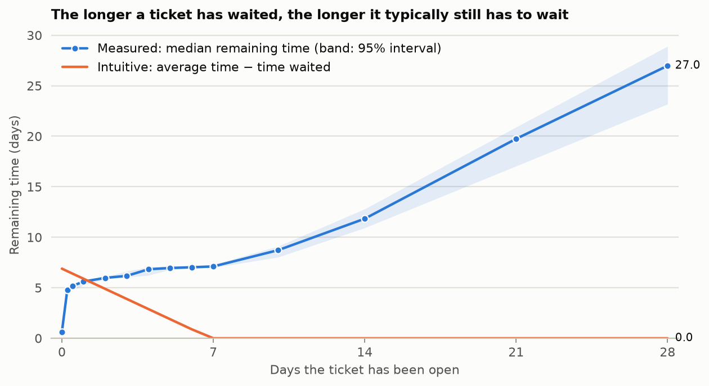

# When will this ticket be done?

Survival analysis on the support tickets of an IT company: 24,918 incidents, 141,712 logged updates
(a ServiceNow export published on UCI). The project shows two common mistakes on real data and then
predicts, for every open ticket, the chance it is resolved in the coming days.

**Status: work in progress.** The data layer and the first two findings are done; the prediction model,
its comparison with simple rules, and the demo are next.

## Findings so far

All numbers below are produced by `python run_all.py` and checked in `tests/`.

### 1. The average of resolved tickets understates how long work takes

Every Monday from 7 March to 27 June 2016 the clock is stopped and "how long do our tickets take?" is
answered three ways for the tickets opened so far: from the tickets already resolved that day (what a
dashboard shows), with Kaplan–Meier (which also counts the tickets that are still open), and with
what later turned out to be true.


| On 4 April 2016 (16% of tickets still open) | Resolved tickets only | Kaplan–Meier | What actually happened |
|---|---|---|---|
| Mean (days) | 3.7 | not available | 9.1 |
| Median (days) | 1.04 | 2.03 (95% CI 2.0–2.1) | 2.02 |
| 90th percentile (days) | 11.9 | 20.1 | 19.1 |

- The resolved-only mean is below the truth on all 17 Mondays; with 98% of tickets resolved at the end
  of June it is still 4.5 days against 6.9.
- On the 13 Mondays from 4 April on, the Kaplan–Meier median is within 0.05 days of the truth.
- Limits: Kaplan–Meier does not give a mean, because the long tail has not been observed yet. Early
  on it cannot give every quantile either: on 7 March, 53% of tickets were open and the median was
  not estimable; the 90th percentile becomes estimable from 28 March.

Broken down by opening week, the dashboard of 2 May shows the most recent week at 0.3 days on
average; those tickets ended at 3.7 days. Times really were falling, but the dashboard exaggerates it.


### 2. The longer a ticket has waited, the longer it still has to wait

The intuitive rule is "tickets take 6.9 days on average, this one has been open for 5, so about 2 to
go". Measured on the complete data, the median remaining time goes the other way:

| Ticket has been open for | Still open | Median remaining (95% bootstrap interval) | Resolved within next 24 h |
|---|---|---|---|
| just opened | 24,918 | 0.63 days (0.46–0.71) | 55% |
| 1 day | 11,228 | 5.6 days (5.3–5.8) | 16% |
| 7 days | 5,286 | 7.1 days (7.0–7.3) | 12% |
| 28 days | 1,235 | 27.0 days (23.2–28.9) | 5% |



## How open tickets are recreated

Every ticket in the file is closed. To get "open" tickets, the clock is stopped at a cutoff time and
every update after it is hidden (`sql/03_snapshot.sql`). What is hidden is then used to score the
estimates. `tests/test_no_leakage.py` rewrites and deletes everything after the cutoff and requires
the snapshot to stay identical.

Four columns of the export (`resolved_at`, `closed_at`, `closed_code`, `resolved_by`) hold their final
value on every row of a ticket, including the first one, so they are kept out of the event table.
Resolution time is taken from the update log instead: the moment the ticket entered Resolved/Closed
for the last time. Where the export's `resolved_at` exists (23,362 tickets; it is missing for 1,556),
the two agree for 98.7%.

## Run it

```bash
python -m venv .venv && .venv/bin/pip install -r requirements.txt
.venv/bin/python run_all.py      # downloads the data (2.4 MB), builds the database, tables and figures
.venv/bin/python -m pytest
```

| Path | What |
|---|---|
| `sql/` | Table definitions and the point-in-time snapshot macros (DuckDB) |
| `src/db.py` | Download, build, query |
| `src/analysis/` | The findings above |
| `reports/tables/`, `reports/figures/` | Outputs |
| `tests/` | Dataset facts, leakage test, the numbers quoted here |

## Data

Amaral, C., Fantinato, M., Peres, S. (2018). *Incident management process enriched event log*.
UCI Machine Learning Repository. DOI [10.24432/C57S4H](https://doi.org/10.24432/C57S4H). Licence CC BY 4.0.
The data is downloaded on first run and is not stored in this repository.
