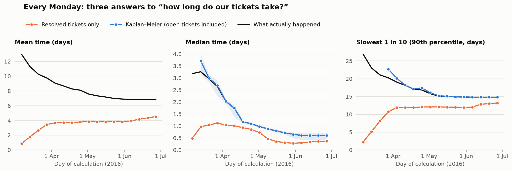
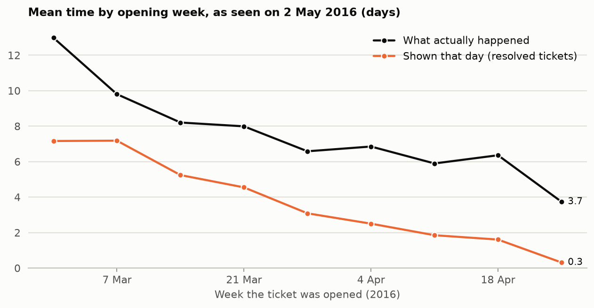
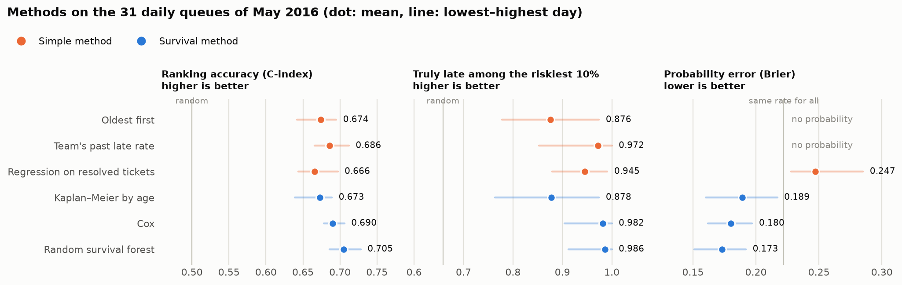
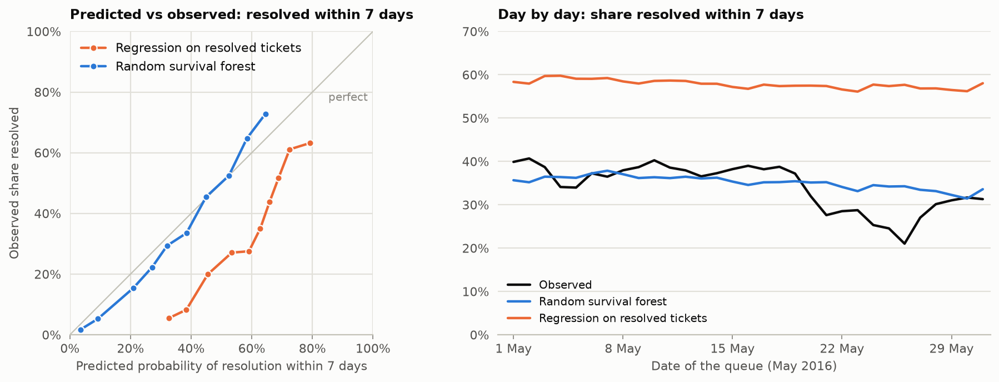

# When will this ticket be done?

Survival analysis on the support tickets of an IT company: 24,918 incidents, 141,712 logged updates
(a ServiceNow export published on UCI). The project shows two common mistakes on real data and then
predicts, for every open ticket, the chance it is resolved in the coming days.

The demo (`streamlit run app/app.py`, interface in Turkish) goes back to any day of May 2016, ranks
that morning's open tickets by their risk of being late, and can then reveal what really happened.

## Findings

All numbers below are produced by `python run_all.py` and checked in `tests/`.

### 1. The average of resolved tickets understates how long work takes

Every Monday from 7 March to 27 June 2016 the clock is stopped and "how long do our tickets take?" is
answered three ways for the tickets opened so far: from the tickets already resolved that day (what a
dashboard shows), with Kaplan–Meier (which also counts the tickets that are still open), and with
what later turned out to be true.



| On 4 April 2016 (16% of tickets still open) | Resolved tickets only | Kaplan–Meier | What actually happened |
|---|---|---|---|
| Mean (days) | 3.7 | not available | 9.1 |
| Median (days) | 1.04 | 2.03 (95% CI 2.0–2.1) | 2.02 |
| 90th percentile (days) | 11.9 | 20.1 | 19.1 |

- The resolved-only mean is below the truth on all 17 Mondays; with 98% of tickets resolved at the end
  of June it is still 4.5 days against 6.9.
- On the 13 Mondays from 4 April on, the Kaplan–Meier median is within 0.05 days of the truth.
- Limits: Kaplan–Meier does not give a mean, because the long tail has not been observed yet. Early
  on it cannot give every quantile either: on 7 March, 53% of tickets were open and the median was
  not estimable; the 90th percentile becomes estimable from 28 March.

Broken down by opening week, the dashboard of 2 May shows the most recent week at 0.3 days on
average; those tickets ended at 3.7 days. Times really were falling, but the dashboard exaggerates it.



### 2. The longer a ticket has waited, the longer it still has to wait

The intuitive rule is "tickets take 6.9 days on average, this one has been open for 5, so about 2 to
go". Measured on the complete data, the median remaining time goes the other way:

| Ticket has been open for | Still open | Median remaining (95% bootstrap interval) | Resolved within next 24 h |
|---|---|---|---|
| just opened | 24,918 | 0.63 days (0.46–0.71) | 55% |
| 1 day | 11,228 | 5.6 days (5.3–5.8) | 16% |
| 7 days | 5,286 | 7.1 days (7.0–7.3) | 12% |
| 28 days | 1,235 | 27.0 days (23.2–28.9) | 5% |


### 3. Predicting which open tickets will be late

"Late" means not resolved within 7 days of the day the queue is looked at. Models are fitted on what
was known on 1 May 2016 (28,125 rows: tickets open at cutoffs every 3 days in March and April, 28% of
them still open on 1 May and kept as censored observations). They are tested on the queue of open
tickets on each of the 31 days of May (about 1,200 tickets a day, 66% of them late), which the models
never saw. Each cell is the mean over the 31 daily queues, with the lowest and highest day in brackets.

| Method | Ranking (C-index) | Truly late among the riskiest 10% | Probability error (Brier) |
|---|---|---|---|
| Oldest first | 0.674 [0.642–0.695] | 0.876 [0.778–0.974] | no probability |
| Team's past late rate, then oldest | 0.686 [0.666–0.712] | 0.972 [0.853–1.000] | no probability |
| Regression on resolved tickets only | 0.666 [0.644–0.697] | 0.945 [0.879–0.991] | 0.247 |
| Kaplan–Meier by age (no ticket attributes) | 0.673 [0.639–0.689] | 0.878 [0.764–0.974] | 0.189 |
| Cox proportional hazards | 0.690 [0.678–0.706] | 0.982 [0.904–1.000] | 0.180 |
| Random survival forest | 0.705 [0.686–0.728] | 0.986 [0.912–1.000] | 0.173 |

For reference: random ranking has a C-index of 0.5, and giving every ticket the same 66% has a Brier
score of 0.222.



What this does and does not show:

- **The survival forest is the best method on every measure, but its ranking edge is small.** It
  beats "oldest first" on all 31 days (C-index 0.705 against 0.674).
- **Most of that edge is one team.** Every ticket in the forest's riskiest 10% belongs to one
  assignment group ("Group 9"), which holds 18.9% of the May queue and whose tickets are late 97% of
  the time. A one-variable rule, ranking by each team's past late rate, already reaches 0.972 in the
  riskiest 10%. Without that team's tickets the forest scores 0.665 / 0.853 against 0.659 / 0.848 for
  "oldest first" (ahead on 24 of 31 days for the C-index and on 19 for the riskiest 10%), and Cox
  falls *below* the rule (0.643 / 0.806). Outside that team, the model ranks no better than the rule
  of thumb in any way that matters.
- **What the survival models add is a probability that holds up.** The forest predicts 65% late on
  average; the truth is 66%. The regression fitted on resolved tickets predicts 42%: it never saw the
  7,760 rows that were still open, so it is far too optimistic, and its Brier score (0.247) is worse
  than giving everyone the base rate. This is finding 1 again, in a prediction.
- **The process drifts.** In the queues of 21–26 May the share resolved within 7 days falls from the
  34–41% of 1–19 May to 21–29%. The model, fitted on 1 May, stays too optimistic (26 May: 34%
  predicted, 21% observed).



Limits. The same ticket sits in many daily queues, so the days are not independent; that is why the
spread across days is reported rather than a confidence interval. The model knows nothing about the
calendar (on two cutoff days almost nothing was resolved in the following 24 hours, which looks like
public holidays; not verified). The forest's leaf size was the only setting tuned, on April data
(`reports/tables/model_selection.csv`).

## How open tickets are recreated

Every ticket in the file is closed. To get "open" tickets, the clock is stopped at a cutoff time and
every update after it is hidden (`sql/03_snapshot.sql`). What is hidden is then used to score the
estimates. `tests/test_no_leakage.py` rewrites and deletes everything after the cutoff and requires
the snapshot to stay identical.

Four columns of the export (`resolved_at`, `closed_at`, `closed_code`, `resolved_by`) hold their final
value on every row of a ticket, including the first one, so they are kept out of the event table.
Resolution time is taken from the update log instead: the moment the ticket entered Resolved/Closed
for the last time. Where the export's `resolved_at` exists (23,362 tickets; it is missing for 1,556),
the two agree for 98.7%.

## Run it

```bash
python -m venv .venv && .venv/bin/pip install -r requirements.txt
.venv/bin/python run_all.py      # downloads the data (2.4 MB), builds everything; about 7 minutes
.venv/bin/python -m pytest
.venv/bin/streamlit run app/app.py
```

| Path | What |
|---|---|
| `sql/` | Table definitions and the point-in-time snapshot macros (DuckDB) |
| `src/db.py` | Download, build, query |
| `src/analysis/` | Findings 1 and 2, and the figures for finding 3 |
| `src/features.py`, `src/models.py`, `src/evaluate.py` | Model input, the six methods, the May test |
| `app/app.py` | The demo; reads `app/data/predictions.parquet` (derived from the data, written by `run_all.py`) |
| `reports/tables/`, `reports/figures/` | Outputs |
| `tests/` | Dataset facts, leakage tests, methods and scoring, the demo |

## Data

Amaral, C., Fantinato, M., Peres, S. (2018). *Incident management process enriched event log*.
UCI Machine Learning Repository. DOI [10.24432/C57S4H](https://doi.org/10.24432/C57S4H). Licence CC BY 4.0.
The data is downloaded on first run and is not stored in this repository.
