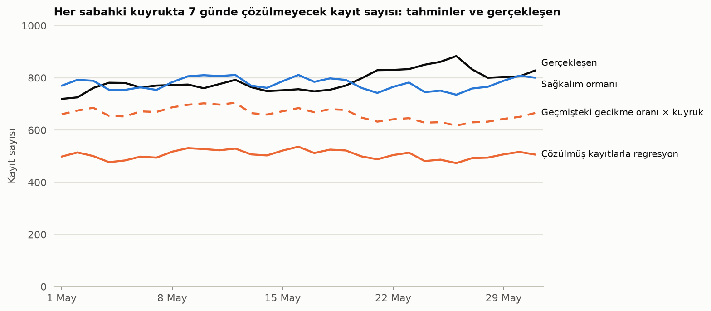

# Bu iş ne zaman biter?

*Bir BT destek masasının 24.918 kaydında sağkalım analizi.*

## Soru

Bir destek masasında her sabah yaklaşık 1.200 kayıt açık durur. Yönetici iki şey bilmek ister:
**işlerimiz ne kadar sürüyor** ve **şu an açık olanlardan hangileri, kaç tanesi gecikecek?**
İki soruya da verilen alışılmış cevaplar yanıltıyor, çünkü henüz bitmemiş işleri hesaba katmıyor.
Bu çalışma, bitmemiş işleri hesaptan atmayan yöntemi (sağkalım analizi) gerçek bir şirketin
kayıtlarına uyguluyor ve her iddiayı sonradan gerçekleşenle karşılaştırıyor.

**Veri:** bir BT şirketinin kayıt sisteminden alınmış 24.918 destek kaydı ve bu kayıtlara yapılan
141.712 güncelleme (Mart–Mayıs 2016; UCI, açık veri). Bütün kayıtlar sonunda kapanmış olduğu için,
geçmişte bir güne gidip o günden sonrasını gizleyerek "o sabah ne biliniyordu" durumu yeniden
kuruldu; gizlenen kısım tahminleri sınamak için kullanıldı.

## Bulgu 1. Rapor, işlerin ne kadar sürdüğünü olduğundan kısa gösteriyor

Ortalama süre, bitmiş işlerden hesaplanır. Uzun süren işler henüz bitmediği için hesaba girmez.
4 Nisan 2016'da rapor ortalamayı **3,7 gün** gösterirdi; o kayıtların gerçek ortalaması **9,1 gün**
çıktı. Bu hata 17 haftanın 17'sinde aynı yönde. Açık kayıtları da hesaba katan yöntem (Kaplan–Meier)
aynı gün ortanca süreyi 2,03 gün buldu; gerçekleşen 2,02 gün (rapordaki değer 1,04).

## Bulgu 2. Uzun bekleyen kayıt, daha da uzun bekliyor

"Ortalama 7 gün sürüyor, bu kayıt 5 gündür açık, 2 günü kaldı" mantığı yanlış. Yeni açılan kaydın
tipik kalan süresi 0,6 gün; 1 gündür açık olanın 5,6 gün; 7 gündür açık olanın 7,1 gün; 28 gündür
açık olanın 27 gün. Hızlı işler ilk gün biter; geriye kalanlar zor işlerdir.

## Bulgu 3. "Bu hafta kaç kayıt elimizde kalacak?" sorusu doğru cevaplanabiliyor

Mayıs 2016'nın her sabahı için, o gün açık olan kayıtların kaçının 7 gün içinde çözülmeyeceği tahmin
edildi (model yalnız 1 Mayıs'a kadar olanları gördü). Gerçekte günde ortalama **788** kayıt çözülmedi.
Sağkalım yöntemleri günde ortalama **40–44 kayıt** şaştı. Aynı tahmini yalnız bitmiş işlerden öğrenen yöntem
**282 kayıt** şaştı ve 31 günün 31'inde eksik tahmin etti. Model kullanmadan, geçmişteki gecikme
oranını bugünkü kuyruğa uygulamak 69–126 kayıt şaştırıyor.

## Bulgu 4. Hangi kayda önce bakılacağını seçmekte model, basit kuraldan pek iyi değil

Açık kayıtlar gecikme riskine göre sıralandığında en iyi model (sağkalım ormanı) "en eski kayda önce
bak" kuralını 31 günün 31'inde geçiyor, ama fark küçük (sıralama doğruluğu 0,705'e 0,674). Farkın
çoğu tek bir ekipten geliyor: bu ekip açık kayıtların %19'unu tutuyor ve kayıtlarının %97'si
gecikiyor. O ekip dışarıda bırakılınca model ile kural neredeyse eşit (0,665'e 0,659). Yani sıralama
için pahalı bir modele gerek yok; asıl bulgu, gecikmenin bir ekipte yığıldığı.

## Sınırlar

- Model 1 Mayıs'ta bir kez kuruldu. Mayıs'ın son haftasında işler yavaşlayınca iyimser kaldı
  (26 Mayıs: "%34'ü çözülür" dedi, %21'i çözüldü). Düzenli yeniden kurma gerekir; denenmedi.
- Verideki ekip ve kategori adları takma ad ("Group 9"); o ekibin neden yavaş olduğu veriden
  anlaşılamıyor.
- Bu, geçmiş veri üzerinde bir gösterim; canlı bir sisteme bağlı değil.

Kod, testler ve bütün sayıların nasıl üretildiği: depodaki `README.md`. Canlı gösterim:
`streamlit run app/app.py`.
