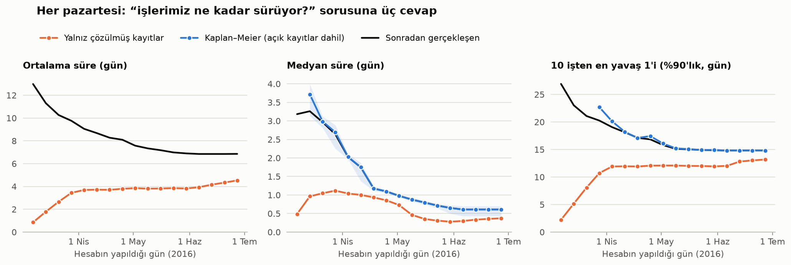
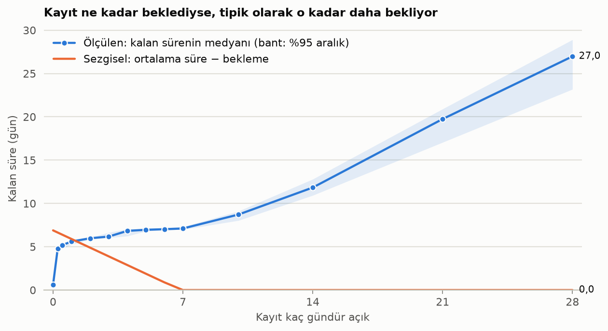
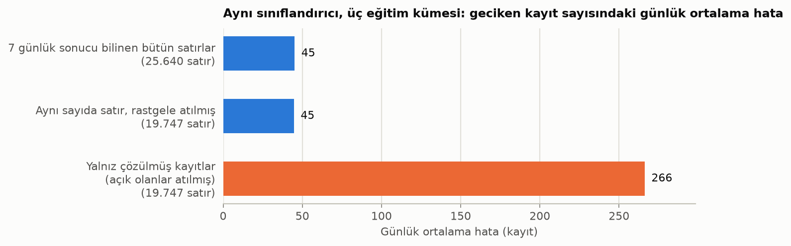
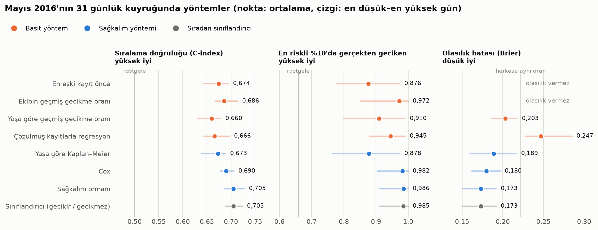

# Bu iş ne zaman biter?

*Bir BT destek masasının 24.918 kaydında, bitmemiş işleri hesaptan atmadan süre ölçümü ve iş yükü tahmini.*

## Soru

Bir destek masasında biri sorun bildirir, kayıt açılır, bir ekibe atanır, çözülür. Bu şirkette her
sabah yaklaşık 1.200 kayıt açık duruyor. Yöneticinin iki sorusu var: **işlerimiz ne kadar sürüyor**
ve **şu an açık olanlardan kaçı bir hafta sonra hâlâ elimizde olacak, hangileri?**

Çalışmanın tek fikri şu: **henüz bitmemiş iş hesabın içinde kalmalı.** Açık kayıtları hesaptan atan
her ölçüm ve her tahmin, işleri olduğundan hızlı gösteriyor. Aşağıdaki her sayı, sonradan
gerçekleşenle karşılaştırılarak ölçüldü.

**Veri:** bir BT şirketinin kayıt sisteminden alınmış 24.918 destek kaydı ve bu kayıtlara yapılan
141.712 güncelleme (çoğu Mart–Mayıs 2016'da açılmış; UCI, açık veri). Bütün kayıtlar sonunda
kapanmış olduğu için, geçmişte bir güne gidip o günden sonrasını gizleyerek "o gün ne biliniyordu"
durumu yeniden kuruldu; gizlenen kısım tahminleri sınamak için kullanıldı.

## Bulgu 1. Bitmiş işlerden hesaplanan süre, gerçeğin altında kalıyor

Ortalama süre bitmiş işlerden hesaplanır; uzun süren işler henüz bitmediği için hesaba girmez.
4 Nisan 2016'da bu hesap **3,7 gün** gösterirdi; aynı kayıtların gerçek ortalaması **9,1 gün** çıktı.
Hata 17 pazartesinin 17'sinde aynı yönde.

Doğru ortalama o gün hiçbir yöntemle bilinemez, çünkü en uzun işlerin ne kadar süreceği henüz belli
değildir. Bilinebilen şey ortanca ve yüzdelikler. Açık kayıtları "en az şu kadar sürdü" bilgisiyle
hesaba katan Kaplan–Meier yöntemi o gün "işlerin yarısı 2,03 günde, %68'i 7 günde biter" dedi;
gerçekleşen 2,02 gün ve %70. Bitmiş işlerden hesaplanan değerler 1,04 gün ve %79'du. Yöntem ilk iki
haftada, veri azken tutmuyor; 21 Mart'tan sonra ortancayı en çok 0,06 gün farkla buluyor.

## Bulgu 2. Uzun bekleyen kayıt, daha da uzun bekliyor

"Ortalama 7 gün sürüyor, bu kayıt 5 gündür açık, 2 günü kaldı" mantığı yanlış. Yeni açılan kaydın
tipik kalan süresi 0,6 gün; 1 gündür açık olanın 5,6 gün; 7 gündür açık olanın 7,1 gün; 28 gündür
açık olanın 27 gün. Hızlı çözülen işler kuyruktan çıkar, geriye uzun sürenler kalır. Bu sayılar
işlerin neden uzun sürdüğünü söylemez.

İki itiraz ölçüldü. Uzun işlerin çoğunu tutan tek ekip çıkarılınca sıra aynı (5,2 / 6,8 / 18,1 gün).
Çözümlerin toplu girilmesi de açıklamıyor: aynı dakikada beş ve daha çok kaydın çözüldüğü durumlar
kayıtların %0,4'ü ve çıkarılınca sonuç değişmiyor.

## Bulgu 3. Bir hafta sonra elde kaç kayıt kalacağı tahmin edilebiliyor

Mayıs 2016'nın her günü için, o gün açık olan kayıtların kaçının 7 gün içinde çözülmeyeceği tahmin
edildi; modeller yalnız 1 Mayıs'a kadar bilinenlerle kuruldu. Gerçekte günde ortalama **788** kayıt
çözülmedi.

| Yöntem | Günlük ortalama hata (kayıt) |
|---|---|
| Açık kayıtları hesaba katan dört yöntem | 40–45 |
| Model yok: geçmişteki gecikme oranını bugünkü kuyruğa uygulamak | 69–126 |
| Yalnız bitmiş işlerden öğrenen model | 282 |

Farkı yaratan modelin türü değil, açık işlerin atılmaması. Aynı model üç ayrı veriyle kuruldu:
sonucu bilinen bütün satırlarla günde 45 kayıt şaştı; 1 Mayıs'ta hâlâ açık olan kayıtların
satırları atılınca 266 kayıt; aynı sayıda satır rastgele atılınca yine 45 kayıt.
Kayıtların özelliklerine hiç bakmayan en basit yöntem (Kaplan–Meier) 40 kayıt şaşıyor. "7 günde
çözülür mü?" sorusunu doğrudan öğrenen sıradan bir sınıflandırıcı da aynı sonucu veriyor; yani bu iş
için özel bir sağkalım modeli şart değil. Bulgu 4'teki tek ekip çıkarılınca model kullanmayan hesap
da modeller kadar iyi: 47 kayda karşı 46–48 kayıt.

## Bulgu 4. Hangi kayda önce bakılacağını seçmekte model, basit kuralı geçemiyor

Açık kayıtlar gecikme riskine göre sıralandığında en iyi model, "en eski kayda önce bak" kuralından
iyi görünüyor (sıralama doğruluğu 0,705'e 0,674). Ama bu fark tek bir ekipten geliyor: ekip açık
kayıtların %19'unu tutuyor ve kayıtlarının %97'si gecikiyor. Ekip çıkarılıp bütün yöntemler yeniden
kurulunca model ile kural eşit (0,662'ye 0,659). Bu ekibi yönetici büyük ihtimalle zaten
biliyor; o yüzden sıralama için bir modele gerek olduğu bu veriden çıkmıyor.

## Sınırlar

- Tek şirket, kayıtların çoğu üç ayda açılmış. Başka bir şirkette ya da dönemde sınanmadı.
- 7 günlük gecikme eşiği bu çalışma için seçildi.
- Model 1 Mayıs'ta kuruldu; Mayıs'ın son haftasında işler yavaşlayınca iyimser kaldı (26 Mayıs:
  "%34'ü çözülür" dedi, %21'i çözüldü). Modeli her hafta yeniden kurmak ayın ortalama hatasını 43
  kayıttan 41 kayda indirdi; iyimserlik sürdü.
- Olasılıklar ortalamada tutuyor (tahmin %65, gerçekleşen %66), her ekipte değil: ikinci büyük
  ekip için model %54 gecikir dedi, %75'i gecikti.
- Mayıs'ta sınanan 4.078 kaydın 1.039'u Nisan'da da açıktı ve eğitim verisinde de yer alıyor
  (sonuçları değil, o günkü halleri).
- Ekip ve kategori adları takma ad ("Group 9"); o ekibin neden yavaş olduğu veriden anlaşılamıyor.
- Bu, geçmiş veri üzerinde bir gösterim; canlı bir sisteme bağlı değil.

Kod, testler ve bütün sayıların nasıl üretildiği: depodaki `README.md`. Canlı gösterim:
`streamlit run app/app.py`.
